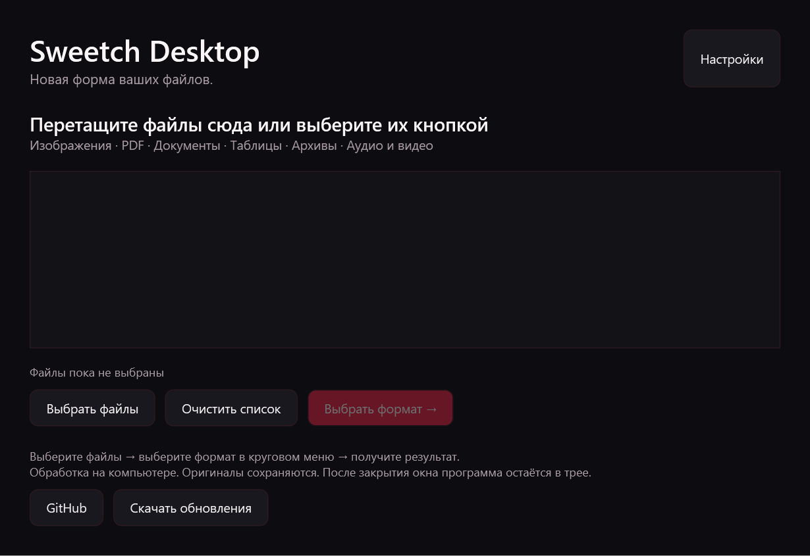
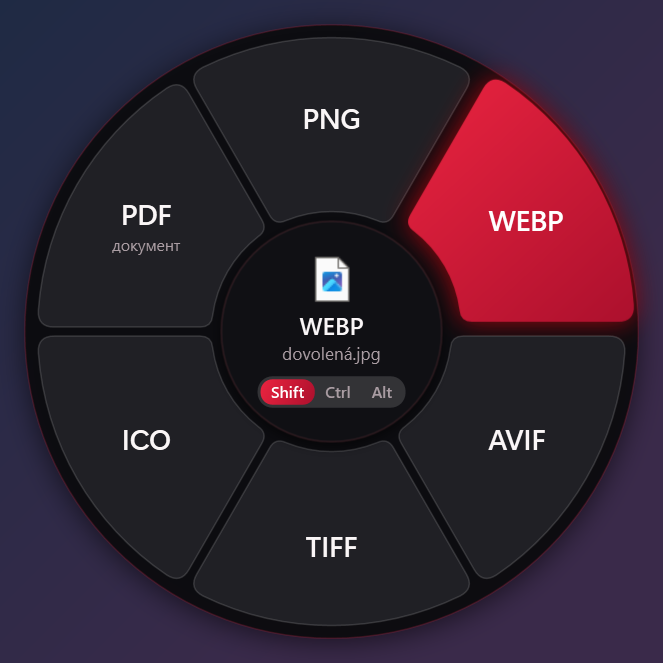
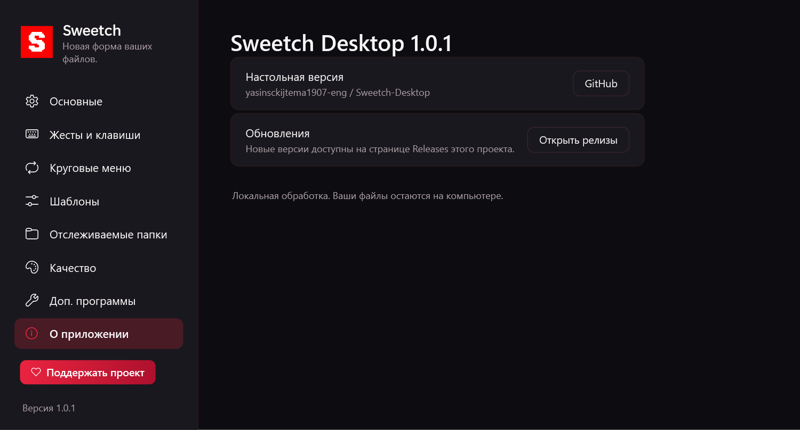

# Sweetch Desktop

Настольный конвертер файлов для **Windows 10/11 x64**: главное окно с выбором файлов, перетаскивание и круговое меню. Файлы обрабатываются на компьютере, результаты сохраняются отдельно от оригиналов.

**[Скачать готовую программу → Releases](https://github.com/yasinsckijtema1907-eng/Sweetch-Desktop/releases/latest)**

В версии 1.0.2 кнопка «Поддержать проект» открывает [страницу поддержки в Ozon Банке](https://finance.ozon.ru/apps/sbp/ozonbankpay/01a15626-f41a-7445-915d-3349d0f96806) в браузере. Адрес также виден во всплывающей подсказке кнопки.





В версии 1.0.1 со страницы «О приложении» убраны блоки «Исходный проект» и «Обратная связь», а из меню в трее — пункт отправки отзыва. Лицензии и уведомления об авторских правах сохранены в файлах дистрибутива.



## Запуск

1. Скачайте `SweetchDesktop-1.0.2-win-x64.zip` из раздела Releases.
2. Распакуйте **весь архив**, включая папку `tools`.
3. Запустите **SweetchDesktop.exe**. Устанавливать .NET не нужно.
4. Нажмите **«Выбрать файлы»** или перетащите их в окно → **«Выбрать формат»** → нажмите нужный сектор кругового меню.

Закрытие окна оставляет приложение в трее рядом с часами. Двойной щелчок по значку снова открывает окно. Для завершения выберите **«Выход»** в меню значка.

## Возможности

- Изображения: изменение формата, сжатие и другие инструменты.
- PDF: страницы в изображения, объединение, разделение, поворот и извлечение текстового слоя.
- Документы, таблицы, презентации, субтитры и архивы.
- Аудио и видео через FFmpeg.
- Русский и английский интерфейс; светлая и тёмная темы.
- Пользовательские пресеты и наблюдаемые папки.
- При перетаскивании: **Shift** — конвертация, **Ctrl** — инструменты, **Alt** — действия.
- **Ctrl + Alt + Space** — меню для выбранных в Проводнике файлов.

**Pandoc 3.12.1 включён** в готовую сборку; его официальный архив проверяется по SHA-256. FFmpeg можно скачать из настроек. Для части операций Office/PDF нужен отдельно установленный LibreOffice. Доступные операции зависят от входного формата и установленных инструментов. Извлечение текста из PDF требует текстового слоя; сканы можно распознать инструментом OCR при наличии языков Windows OCR.

## Эта версия

Основана на [krllmrzv/Sweetch](https://github.com/krllmrzv/Sweetch), исходный коммит `dbecc83c245911b097ef7b142c8dd012cc198fed`. Сохранены конвертеры, круговое меню и уведомления об авторах. Добавлены главное окно, выбор нескольких файлов и drag-and-drop, открытие главного окна из трея, ссылки на собственные релизы и инструкция запуска.

Настройки, загружаемые инструменты, автозапуск и контекстное меню отделены от исходного Sweetch. Автозапуск и пункт в Проводнике включаются пользователем в настройках. Обновления скачиваются вручную со страницы Releases.

Настройки: `%APPDATA%\SweetchDesktop`. Инструменты: `%LOCALAPPDATA%\SweetchDesktop\tools`. Вложения и снимки: `Downloads\SweetchDesktop`.

## Сборка и проверка

Нужны Windows x64, PowerShell и .NET SDK 10. Сборка загружает официальный Pandoc с GitHub.

```powershell
dotnet test tests/Sweetch.Tests -c Release
./build.ps1
$p = Start-Process ./publish/SweetchDesktop.exe -ArgumentList '--self-test', './self-test' -Wait -PassThru
if ($p.ExitCode -ne 0) { throw 'Self-test failed' }
./scripts/package.ps1
```

Готовый архив и SHA-256 появятся в `artifacts/`. Самопроверка строит окна в двух языках и темах, сохраняет изображения в `self-test/` и выполняет реальные конвертации. GitHub Actions повторяет тесты и сборку; при публикации релиза прикрепляет проверенный ZIP и контрольную сумму.

## Авторы и лицензии

Исходный код: **Metamorfolog**. Sweetch, оформление и локализация: **@mmmorozov / krllmrzv**. Настольная версия: **yasinsckijtema1907-eng**.

См. [LICENSE](LICENSE) и [THIRD-PARTY-NOTICES.md](THIRD-PARTY-NOTICES.md). Основной код распространяется по MIT; зависимости сохраняют собственные лицензии. Проект опубликован как производная версия с сохранением авторства оригинала.
